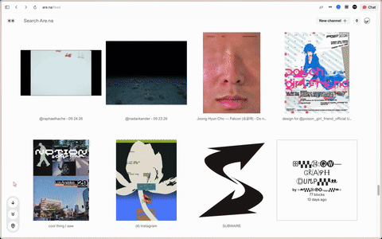

# arena-feed-fix

[English](#english) · [Русский](#русский)

## English

A Chrome extension that cleans up the Are.na following feed (`are.na/` and `are.na/feed`). Unofficial, not affiliated with Are.na; it only changes data inside your own browser.

### What it does
- Hides your own saves, so only people you follow remain.
- Also hides other people saving your blocks or your channels, and people adding things to your channels (turn off with `hideMine` in `inject.js`).
- Removes repeated blocks: a block connected to several channels shows once (the topmost).
- No author/time headers: one continuous Explore-style grid, every row full. Column count follows the window width like Explore (force it with `columns` in `inject.js`).
- Bottom-left pill:
  - ↓ scrolls 10 rows, ↓↓ scrolls 20 rows. Click again while running to queue more runs (dots = queued). Right-click a running arrow to stop and clear the queue.
  - Pin: jumps back to the furthest point you reached (remembered across reloads, searched by block id, keeps loading until found or the feed ends). Click again to cancel. Hover shows a preview, the date and the distance.
  - The ring inside a button shows progress.
  - Right-click menu: Pin current position, Auto-save on/off, Hide your name (on by default; controls the Connect popup tweak below), Reset memory.
- The saved point only moves down: scrolling up or jumping never moves it up. Only Reset memory or a manual pin can set an earlier point. A manual pin is used once, then auto-save continues from there.
- Connect popup (all pages): hides your own name and avatar dot next to your channels. Set your name in `myNames` at the top of `connect.js`. Turn it off with Hide your name in the pill menu (stored in localStorage `afc-hide-name`).

### Install
1. Download or clone this repo.
2. Open `chrome://extensions` and enable Developer mode.
3. Click "Load unpacked" and pick the folder.
4. Reload Are.na. After updating the files, press the reload arrow on the extension card.

### How it works
`inject.js` intercepts the site's own GraphQL `FeedMeQuery` response and rewrites the data (drops your groups and duplicates, packs blocks into one group per page, a multiple of the column count). The site renders the cards itself. Settings are in `CFG` at the top of `inject.js`; logs in DevTools start with `[arena-feed-clean]`.

[Back to top](#top)

## Русский

Расширение для Chrome, которое чистит ленту подписок Are.na (`are.na/` и `are.na/feed`). Неофициальное, меняет данные только в твоём браузере.

### Что делает
- Убирает твои сохранения, остаются только те, на кого подписан.
- Также убирает, когда другие сохраняют твои блоки или каналы, и когда что-то добавляют в твои каналы (выключается `hideMine` в `inject.js`).
- Убирает повторы: блок, добавленный в несколько каналов, показывается один раз (самый верхний).
- Без шапок с автором и временем: одна сплошная сетка как на Explore, все ряды полные. Колонки считаются как на Explore по ширине окна (зафиксировать: `columns` в `inject.js`).
- Кнопки слева внизу:
  - ↓ на 10 рядов, ↓↓ на 20. Повторные клики во время прокрутки ставят ещё циклы в очередь (точки в кнопке). Правый клик по работающей стрелке останавливает и чистит очередь.
  - Булавка: возвращает к самому дальнему месту, до которого долистал (помнится после перезагрузки, ищется по id блока, грузит ленту, пока не найдёт или лента не кончится). Ещё клик = отмена. При наведении превью, дата и расстояние.
  - Кольцо в кнопке показывает прогресс.
  - Правый клик: Pin current position, Auto-save on/off, Hide your name (по умолчанию вкл; управляет скрытием имени в окне Connect, см. ниже), Reset memory.
- Запомненное место двигается только вниз: прокрутка вверх и переходы его не поднимают. Поднять можно только через Reset memory или ручную метку. Ручная метка одноразовая, после перехода к ней снова работает автозапоминание.
- Окно Connect (на всех страницах): прячет твоё имя и кружок у твоих каналов. Имя в `myNames` в начале `connect.js`. Выключается пунктом Hide your name в меню кнопок (localStorage `afc-hide-name`).

### Установка
1. Скачай или склонируй репо.
2. `chrome://extensions`, включи Developer mode.
3. Load unpacked и выбери папку.
4. Обнови Are.na. После обновления файлов жми круглую стрелку у расширения.

### Как устроено
`inject.js` перехватывает ответ запроса сайта `FeedMeQuery` и переписывает данные (убирает твои группы и повторы, складывает блоки страницы в одну группу, кратно числу колонок). Карточки рисует сам сайт. Настройки в `CFG` в начале `inject.js`, логи в консоли с префиксом `[arena-feed-clean]`.

### Если сломается
- Ничего не меняется: в DevTools → Network найди запрос ленты к `graphql`, его `operationName` впиши в `CFG.operation`.
- Видны шапки: логика в `fixHeaders()`.
- Имя в Connect не прячется: впиши его в `myNames` в `connect.js`.

[Наверх](#top)
